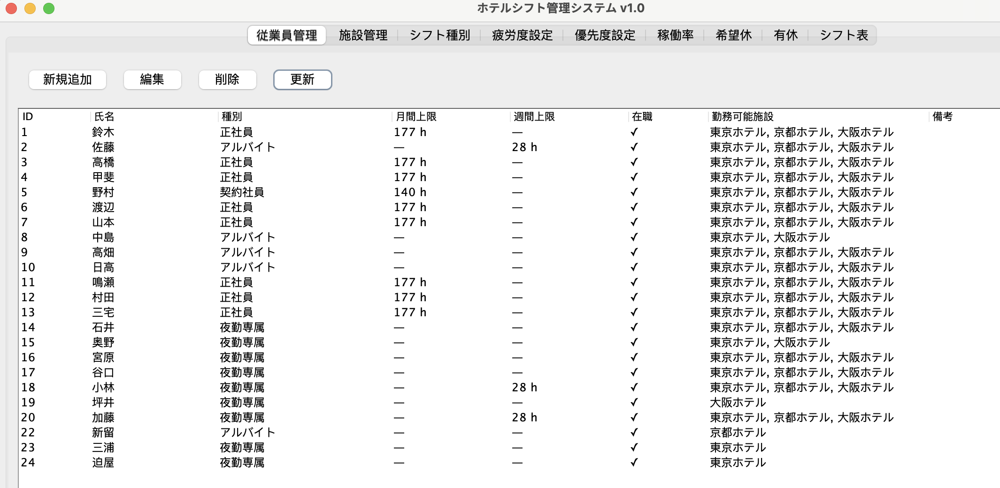
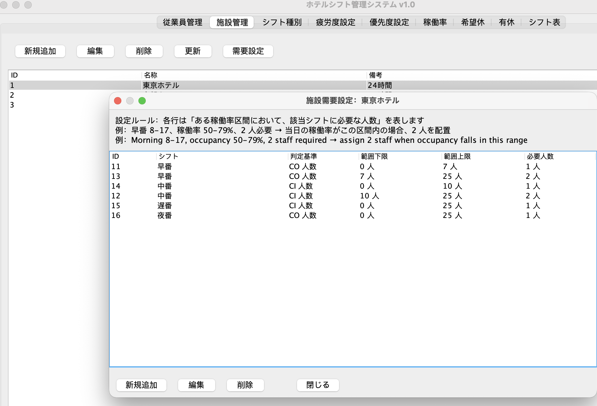
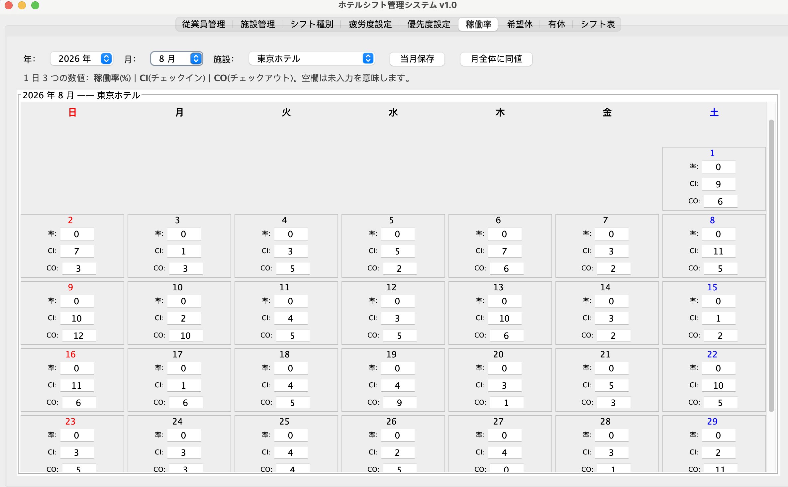
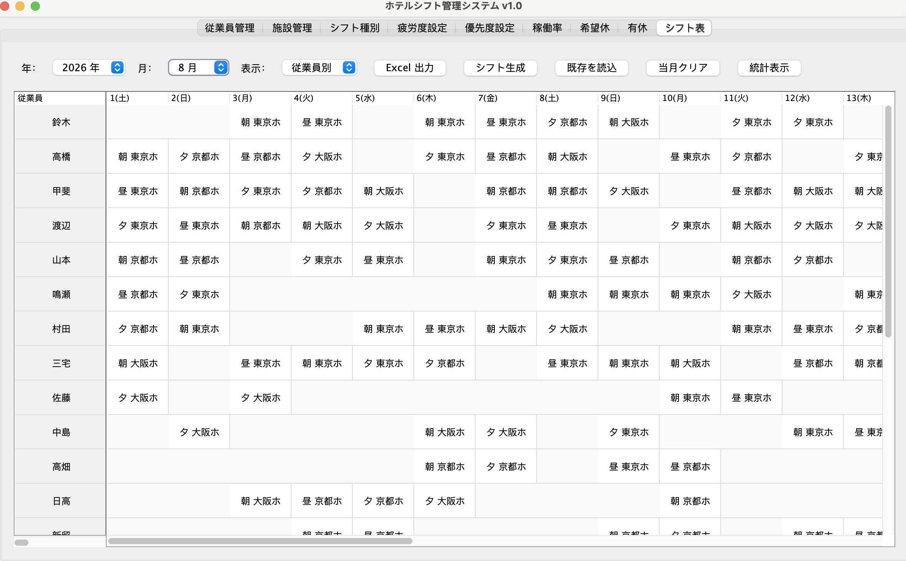
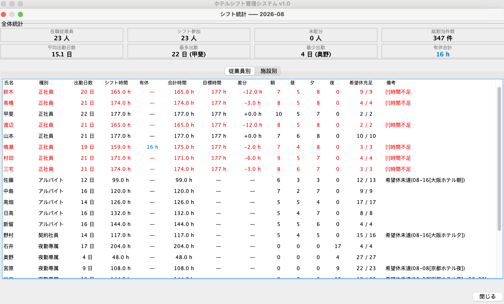
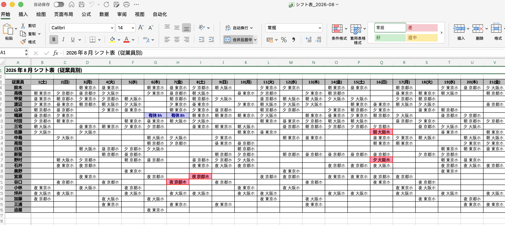
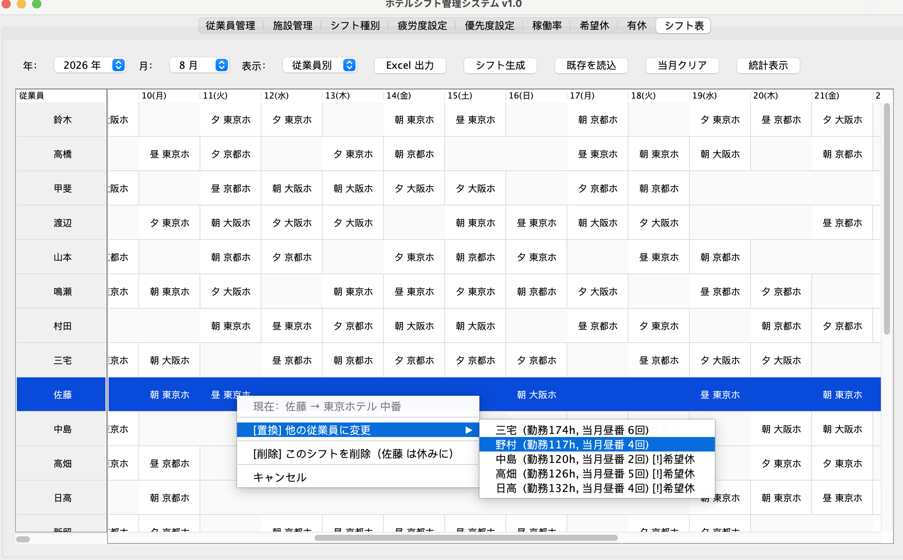

# ホテルシフト管理システム / Hotel Shift Management System

> ホテルフロント業務に特化したシフト自動生成システム。日本の労働基準法に準拠し、稼働率・CI/CO 実績に基づいて各日・各シフトの必要人数を算出、従業員の疲労度・希望休・有給休暇を考慮した最適なシフト表を自動生成します。

> A scheduling automation system for hotel front-desk operations. Complies with Japanese labor law, computes required headcount from occupancy/CI/CO data, and auto-generates optimal shift tables considering employee fatigue, preferred days off, and paid leave.

---

## 📋 プロジェクト概要 / Overview

ホテル運営の現場では、シフト作成は**週 10 時間以上**を要する属人的な作業であり、以下の課題があります：

- **稼働率に応じた必要人数の算出**が経験に依存
- **労働基準法の遵守**（週 40 時間、連続勤務制限、夜勤後の休息）
- **従業員の希望休・有給休暇の考慮**
- **公平な疲労分散**（夜勤の偏り、連続勤務の集中）

本システムは上記全てを自動化し、マネージャーの作業時間を**90% 以上削減**することを目指します。

---

## 🛠 技術スタック / Tech Stack

| 分類 / Category | 技術 / Tech |
|-----|------|
| 言語 / Language | **Java 17** |
| GUI フレームワーク / GUI | **Swing** |
| データベース / DB | **SQLite** (xerial-jdbc 3.45) |
| Excel 出力 / Excel Export | **Apache POI 5.4** |
| ビルドツール / Build | **Maven** |
| バージョン管理 / VCS | **Git / GitHub** |

**依存は最小限に抑え**、エンドユーザー（ホテルマネージャー）が追加のインストールなしで起動できる構成としました。

---

## ✨ 主要機能 / Key Features

### 1. 基礎データ管理 / Master Data Management
- **従業員管理**：種別（正社員 / 契約社員 / アルバイト / 夜勤専属）、月間・週間勤務時間上限、勤務可能施設
- **施設管理**：ホテルごとの基本情報と需要ルール
- **シフト種別**：朝番 / 中番 / 遅番 / 夜番（日跨ぎ対応）
- **疲労度ウェイト**：施設 × シフトの組合せで疲労係数を設定

### 2. 動的需要算出 / Dynamic Demand Calculation
稼働率・CI（チェックイン）・CO（チェックアウト）の実績に応じて、必要人数を段階的に設定可能：

```
例：東京ホテル 中番
├─ CI 0-10 人  → 1 名必要
├─ CI 10-25 人 → 2 名必要
```

### 3. 自動シフト生成 / Automatic Schedule Generation
貪欲法（Greedy Algorithm）による最適化：

- **ハード制約**（9 項目）：施設割当、月間/週間上限、連続勤務日数、夜勤翌日の早番禁止、夜勤専属ルール、有給取得日の除外など
- **ソフト制約**（6 要素）：疲労バランス、シフト回数バランス、希望休充足、連続勤務ペナルティ、種別別優先度

### 4. シフト表表示・編集 / Schedule Display & Editing
- **固定列**：従業員・施設名を常時表示（横スクロールしても見失わない）
- **2 ビュー**：従業員別 / 施設別の切り替え
- **視覚強調**：希望休未達セルを赤枠で表示
- **手動調整**：セルをダブルクリックで置換・削除・新規割当メニュー表示

### 5. 統計レポート / Statistics Report
- 全体統計（出勤者数、総割当件数、有休合計など 8 項目）
- 従業員別（勤務時間、目標との差分、希望休充足率、警告メッセージ）
- 施設別（シフト件数の時間帯別集計）

### 6. Excel 出力 / Excel Export
3 シート構成で出力：
- **従業員別シフト表**：月カレンダー形式、希望休未達は赤枠、有休日は青塗り
- **施設別シフト表**：施設ごとの日別配置
- **勤務時間統計**：14 列の詳細集計

---

## 🏗 アーキテクチャ / Architecture

3 層アーキテクチャで関心を分離：

```
com.hotel
├── Main.java                    # エントリーポイント
├── db/
│   └── DatabaseManager.java     # SQLite 接続・テーブル初期化
├── model/                       # エンティティクラス（7 クラス）
│   ├── Employee / Facility / ShiftType
│   ├── FacilityDemand / Occupancy
│   ├── FatigueWeight / PaidLeave
├── dao/                         # データアクセス層（9 クラス）
│   ├── EmployeeDao / FacilityDao / ShiftTypeDao
│   ├── FacilityDemandDao / OccupancyDao
│   ├── WishOffDao / PaidLeaveDao
│   ├── FatigueWeightDao / ConfigDao / ScheduleDao
├── scheduling/                  # アルゴリズム層
│   ├── SchedulingContext        # 全データのプリロード（性能最適化）
│   ├── SchedulingEngine         # 貪欲法によるシフト割当
│   ├── Task / Assignment        # イミュータブルなドメインオブジェクト
│   └── SchedulingResult
├── ui/                          # プレゼンテーション層（12 クラス）
│   ├── MainFrame                # タブベースのメインウィンドウ
│   ├── 各種 Panel (従業員・施設・シフト・稼働率・希望休・有休・シフト表など)
│   └── 各種 Dialog (需要設定・統計・問題レポート)
└── export/
    └── ExcelExporter            # Apache POI による Excel 生成
```

---

## 🧠 技術的な工夫 / Technical Highlights

### 1. アルゴリズム設計 / Algorithm Design
**貪欲法 + 多要素スコアリング** で実用速度と妥当な結果を両立：

```java
// スコア関数（簡略版）
double score(Employee e, Task task) {
    double s = 0;
    s -= fatigueByEmployee.get(e.getId()) * priorityFatigueBalance;  // 疲労少ない優先
    s -= shiftCount * priorityShiftBalance;                           // シフト均等化
    if (isWishOff) s -= 100 * priorityWishOff;                        // 希望休回避
    if (empType == "正社員") s += 8;                                   // 正社員優先配置
    if (empType == "アルバイト") s -= 5;                               // アルバイト抑制
    return s;
}
```

計算量 **O(タスク数 × 従業員数)**、月数百タスク × 数十従業員で数秒以内に完了。

### 2. イミュータブルなドメインオブジェクト / Immutable Domain Objects
`Assignment` クラスは全フィールド `final`。シフト割当が数千件に及ぶため、スレッド安全性と副作用抑制のためイミュータブル設計を採用。

### 3. データプリロード戦略 / Data Preloading Strategy
`SchedulingContext.load()` で必要な全データ（従業員・施設・シフト・需要・希望休・有休など）をメモリに事前ロード。アルゴリズム実行中は DB 往復なし、性能ボトルネックを回避。

### 4. 固定列 UI の実装 / Fixed Column UI
Swing はネイティブで固定列をサポートしないため、**2 つの JTable + 垂直スクロール同期 + ダミー水平スクロールバー** で実現。

### 5. トランザクション処理 / Transactional Operations
月単位の保存操作（シフト表、希望休）は「旧データ削除 + 新データ一括挿入」をトランザクションで保証。失敗時は自動ロールバック。

```java
try (Connection conn = DatabaseManager.getConnection()) {
    conn.setAutoCommit(false);
    try {
        // delete + batch insert
        conn.commit();
    } catch (SQLException ex) {
        conn.rollback();
        throw ex;
    }
}
```

### 6. 3 言語コメント / Tri-lingual Comments
全ソースファイルで中国語・日本語・英語の 3 言語でコメントを記述。国際チームでの開発や、オフショア開発への展開を想定。

---

## 📸 スクリーンショット / Screenshots

### 従業員管理 / Employee Management


### 施設需要設定 / Facility Demand Configuration


### 稼働率入力 / Occupancy Input


### シフト表（従業員別） / Schedule (By Employee)


### 統計レポート / Statistics Report


### Excel 出力結果 / Excel Output


### 手動調整メニュー / Manual Adjustment Menu


---

## 🚀 起動方法 / How to Run

### 前提条件 / Prerequisites
- **Java 17** 以上
- **Maven 3.6** 以上

### ビルド & 実行 / Build & Run

```bash
# クローン / Clone
git clone https://github.com/sameen313050/HotelScheduling.git
cd HotelScheduling

# ビルド / Build
mvn clean package

# 実行 / Run
mvn exec:java -Dexec.mainClass="com.hotel.Main"
```

初回起動時に `hotel_schedule.db` が自動生成され、デフォルトデータが投入されます。

---

## 🗺 開発ロードマップ / Roadmap

- [x] Phase 1-3: 基礎データ管理（従業員・施設・シフト・需要・稼働率）
- [x] Phase 4: シフト自動生成アルゴリズム
- [x] Phase 5: 手動調整機能 + 有給休暇管理
- [x] Phase 6: Excel 出力機能
- [x] Phase 6+: 国際化対応（日本語 UI + 3 言語コメント）

---

## 📄 ライセンス / License

MIT License

---

## 🙏 謝辞 / Acknowledgments

本システムの設計にあたり、京都市内のホテルフロント業務の実運用知見を反映しています。